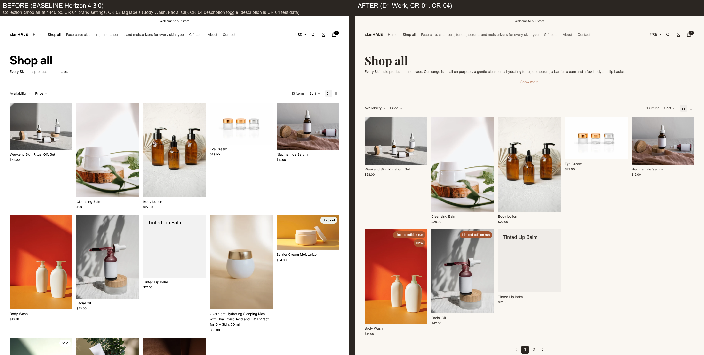
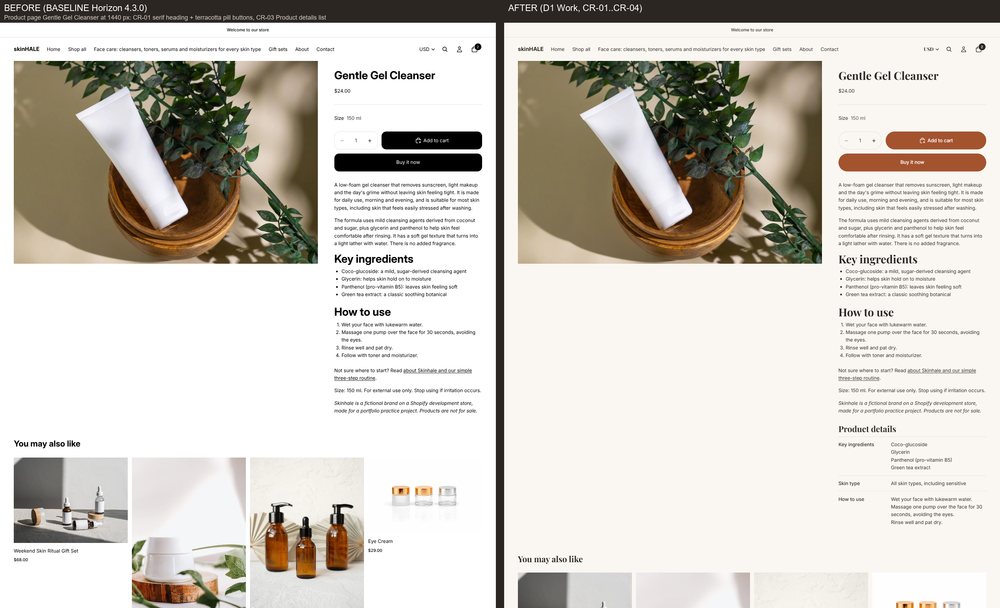

# Shopify theme portfolio — practice projects

> **Practice projects on a Shopify development store with a fictional brand ("Skinhale"). Not client work:** no real customers, orders or sales. Product photos: Pexels (see [CREDITS.md](CREDITS.md)).
>
> **How this was made:** I directed this project: I chose the brand and scope, approved every decision in the brief and decision log, and checked the results. The code, QA runs and write-ups were produced with an AI coding agent (Claude Code). I am now studying the code line by line and rebuilding one change myself.

This repository holds the write-ups, test results, screenshots and the code added to the theme for these projects. The full theme (Horizon by Shopify) stays private because its licence does not allow redistribution.

## Demo 1 — Theme customization from a written brief (Horizon 4.3.0)

Four change requests from a [written brief](demo1/brief.md), each with acceptance criteria tied to a page and a screen width. Built on a copy of the theme; the original stayed untouched for comparison. Nothing was published to a live store.

**Read first:** [Case study](demo1/case-study.md) · [QA checklist](demo1/qa-checklist.md) · [Decision log](demo1/decision-log.md) · [Issue log](demo1/issue-log.md) · Walkthrough video (≤ 5 min): _link coming_

| | |
|---|---|
|  |  |

### CR-01 · Brand settings (no code)
Warm background, deep-brown text, terracotta accent, Playfair Display headings, pill buttons, all set in the theme editor. Every text/button colour pair was checked at ≥ 4.5:1 contrast.

### CR-02 · Product-card labels from product tags
A product tagged `badge:New` shows "New" on its card; up to 2 labels; the merchant can switch them off or choose Filled / Outline.
- Before / after: [before](demo1/images/D1_before_collection-full_1440w_chromium-headless_20261022.png) → [after](demo1/images/D1_CR02_collection-p1-full_1440w_chromium-headless_20261023.png)
- Change log, how to edit, tests: [mini case CR-02](demo1/mini-cases/CR-02.md) · Code: [cr02-tag-badges.liquid](demo1/code/cr02-tag-badges.liquid)
- Editor clip: _link coming_

### CR-03 · Product details from metafields
Key ingredients, Skin type and How to use on the product page; only filled rows show; nothing at all when a product has no data.
- Before / after: [before](demo1/images/D1_before_pdp-full_1440w_chromium-headless_20261022.png) → [after](demo1/images/D1_CR03_pdp-f-full_1440w_chromium-headless_20261024.png) · [partial data](demo1/images/D1_CR03_pdp-p-block_390w_chromium-headless_20261024.png) · [long value at 360 px](demo1/images/D1_CR03_pdp-long-value-block_360w_chromium-headless_20261024.png)
- Change log, how to edit, tests: [mini case CR-03](demo1/mini-cases/CR-03.md) · Code: [cr03-product-details-list.liquid](demo1/code/cr03-product-details-list.liquid)
- Editor clip: _link coming_

### CR-04 · Collection description "Show more / Show less"
Long collection descriptions show the first 30 words and a "Show more" link (native `
`, no JavaScript; the full text stays in the HTML).
- Before / after: [before](demo1/images/D1_before_collection-full_390w_chromium-headless_20261022.png) → [collapsed](demo1/images/D1_CR04_col-shop-all-collapsed_390w_chromium-headless_20261024.png) · [expanded](demo1/images/D1_CR04_col-shop-all-expanded_390w_chromium-headless_20261024.png) · [short text, no link](demo1/images/D1_CR04_col-face-care-short_390w_chromium-headless_20261024.png)
- Change log, how to edit, tests: [mini case CR-04](demo1/mini-cases/CR-04.md) · Code: [cr04-collection-description.liquid](demo1/code/cr04-collection-description.liquid)
- Editor clip: _link coming_

### How it was checked
7 pages × 5 widths (360–1440 px) with no horizontal scroll; functional checks (navigation, search, sort/filter, variants, cart); Microsoft Edge and Firefox spot checks; Shopify Theme Check with no new errors. Not tested: Safari/iOS (no device), checkout (out of scope). Details and limitations: [QA checklist](demo1/qa-checklist.md) and the [case study](demo1/case-study.md#not-tested--limitations).

---
_Demos 2 and 3 will be added here when finished._
