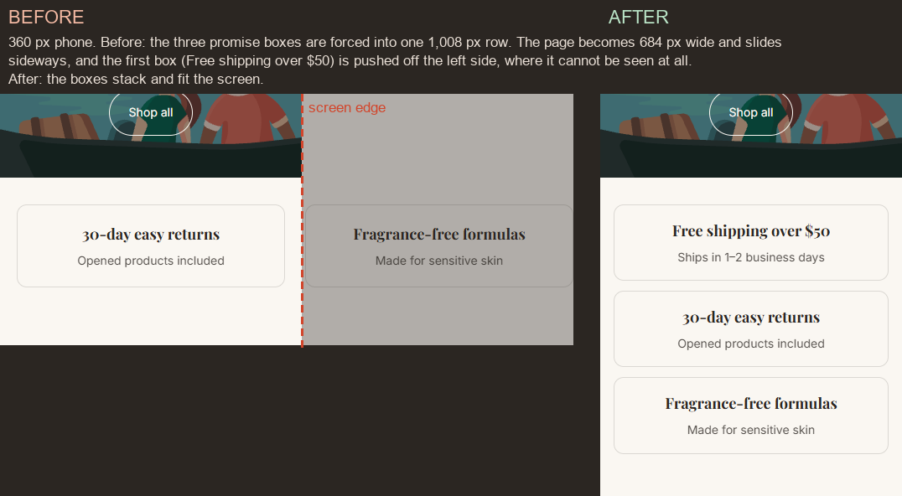
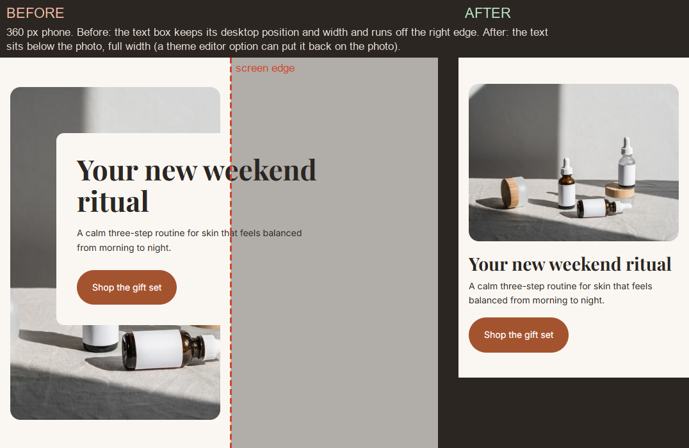
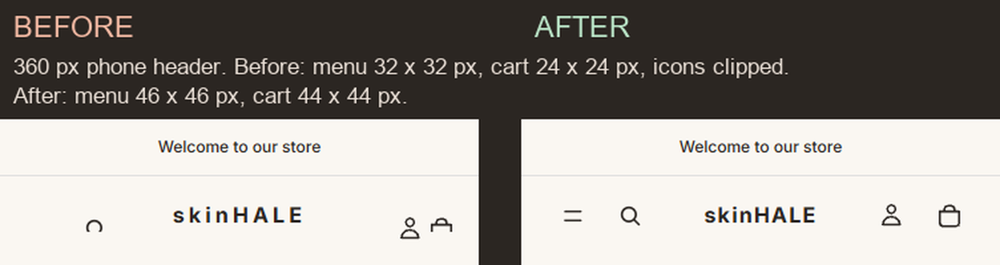
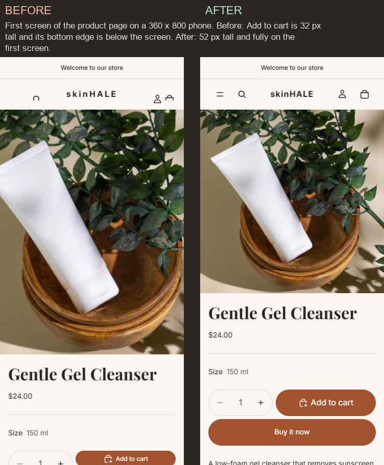
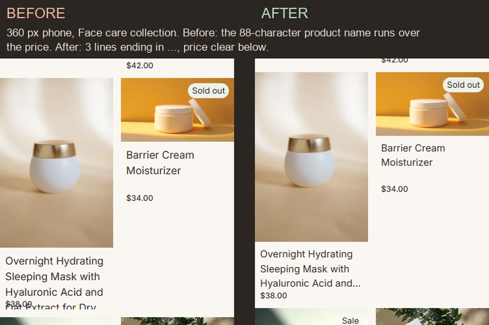
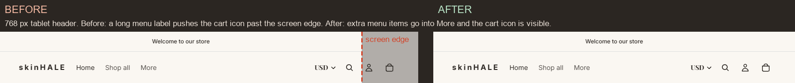
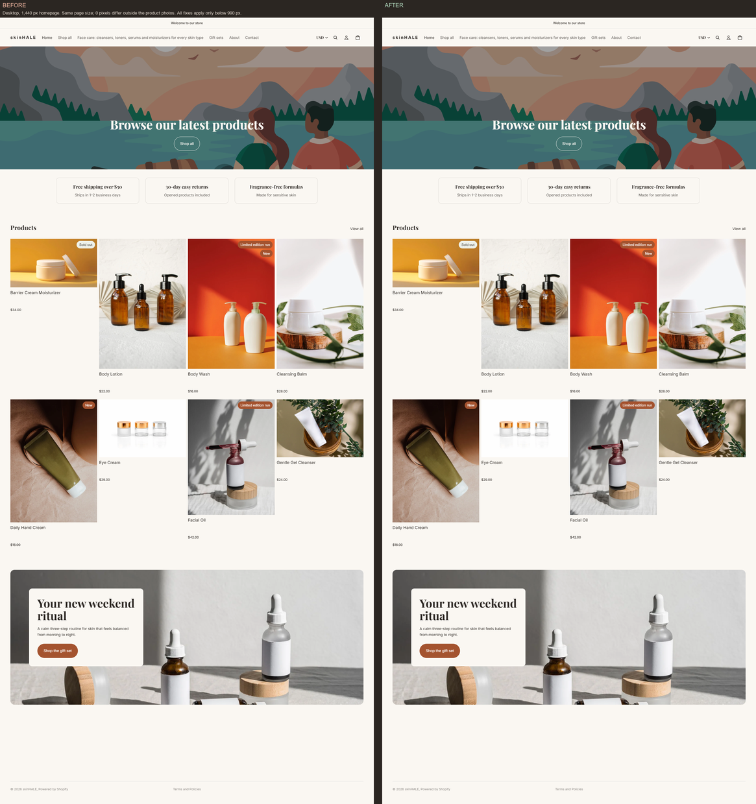

# Fixing a Shopify store that looks broken on phones

> **Practice project, fictional brand ("Skinhale"), Shopify development store.** The "broken" state was **simulated**: I added the kind of code a previous developer might leave behind (checked on a laptop only), then fixed it. No real store, client or sales data. Built with an AI coding agent (Claude Code) under my direction; I chose the problems, reviewed every change and checked the results.

**In one line:** six layout problems on phones and tablets fixed in the theme code. The desktop layout is unchanged: at 1,440 px, 0 pixels differ outside the product photos.

| | |
|---|---|
| Theme | Horizon 4.3.0 with the Demo 1 changes, on a copy of the theme (development theme). Nothing was published. |
| Pages checked | Homepage, a collection page (Face care), a product page (Gentle Gel Cleanser) |
| Screen widths | 360, 390, 414 px (phones), 768 px (tablet), 1,440 px (desktop) |
| Files changed | 3 files with my own code: `assets/store-custom.css`, `sections/trust-bar.liquid`, `sections/promo-banner.liquid`. No Horizon file was edited for the fixes. |
| Time | About 1 working day, including testing and this write-up |

## How I would run this for a real store
1. **Access:** collaborator access with Themes permission only.
2. **Safe copy:** work on a duplicate of the live theme, so shoppers never see half-finished work.
3. **Find:** open the key pages at phone, tablet and desktop widths. For each problem, find the line of code that causes it, not just the symptom.
4. **Fix:** change only phone/tablet rules, so desktop stays as it is. Settings a merchant may want to change go into the theme editor.
5. **Check:** before/after screenshots at each width, a sideways-scroll check, and tap-size checks for the menu, cart and Add to cart.
6. **Hand over:** a preview link and a plain list of what changed. **The store owner publishes** when happy.

---

## 1. The homepage slides sideways on phones

- **Problem:** on a phone, the page could be dragged left and right. Worse, the first promise box ("Free shipping over $50") was pushed off the left side of the screen, where a shopper could not see it at all, even by scrolling.
- **Cause:** the three promise boxes had a fixed width of 320 px each and were forced into one centred row: 1,008 px, much wider than a phone (360–414 px) or a tablet (768 px). Centring pushed the extra width out on both sides.
- **Fix:** below 990 px wide, the boxes may wrap onto new lines and shrink to fit: one per row on phones, three in a row on a tablet. Desktop keeps the original rule.
- **How tested:** sideways scroll measured on the homepage at 360, 390, 414 and 768 px. Before: the page was 297–324 px wider than the screen on phones and 120 px wider at 768 px. After: 0 px at every width.

## 2. Promo text box runs off the screen

- **Problem:** the "Your new weekend ritual" box covered the photo and ran off the right edge of the phone, so part of the text and button was hard to read or reach.
- **Cause:** the text box was placed with fixed desktop values (72 px from the top and left, 440 px wide, 44 px heading).
- **Fix:** on phones the text now sits **below the photo**, full width, with a smaller heading. A new theme editor setting, **"Text on phones: Below the photo / On the photo"**, lets the store owner keep the text on the photo instead; it then sits at the bottom of the photo inside the screen.
- **How tested:** homepage at 360/390/414 px, no part of the box past the screen edge; both setting options previewed at 360 px.

## 3. Header icons too small to tap

- **Problem:** the menu, search, account and cart icons were tiny and clipped; the menu icon was cut off so much that it was barely visible. They were easy to miss with a thumb.
- **Cause:** a "compact header on phones" rule shrank each icon button to 24 × 24 px with no padding. The theme's own size is about 44 × 44 px.
- **Fix:** the shrinking rule was removed, so the icons are back to the theme's size. The logo's letter spacing is slightly smaller on phones, so the logo and four icons fit side by side on a 360 px screen.
- **How tested:** size of the menu button and cart icon measured on all three pages at 360/390/414 px. Before: menu 32 × 32 px, cart 24 × 24 px. After: menu 46 × 46 px, cart 44 × 44 px (target: at least 44 × 44 px). The menu opens and closes at 360 px.

## 4. Add to cart is thin and at the bottom edge of the screen

- **Problem:** on a 360 × 800 phone the Add to cart button was partly below the first screen, and only 32 px tall with small text.
- **Cause:** a "taller photos on phones" rule made the product photo 3:4 (about twice the height), and a "compact buttons" rule made Add to cart 32 px tall with 12 px text.
- **Fix:** the photo is square on phones (still larger than the theme default), and Add to cart is at least 48 px tall with normal-size text.
- **How tested:** button size and position measured at 360 × 800, 390 × 844 and 414 × 896. Before: 32 px tall; bottom edge at 804 px on an 800 px screen. After: 52 px tall; bottom edge at 704 px (360), 734 px (390), 758 px (414), all on the first screen. Product added to the cart at 360 px.

## 5. A long product name spills over the price

- **Problem:** on the Face care collection, the 88-character name "Overnight Hydrating Sleeping Mask with Hyaluronic Acid and Oat Extract for Dry Skin, 50 ml" ran over its price.
- **Cause:** to line prices up on desktop, every card title had a fixed height of 3 lines. A phone card is only about 160 px wide, so this name needs about 6 lines; the extra lines spilled over the price.
- **Fix:** on phones, titles show at most 3 lines and end with "…". The full name stays on the product page. Short titles keep the same 3-line space, so prices still line up.
- **How tested:** Face care collection at 360/390/414 px: the long name ends with "…" on line 3 and the price is clear below it.

## 6. Found while testing: cart icon pushed off-screen on tablets

- **Problem:** at 768 px, the cart icon was outside the screen and could not be tapped.
- **Cause:** this was **not one of the simulated problems**. It was already there in the theme with this store's menu. The menu column takes the width of its content, and one long menu label ("Face care: cleansers, toners, serums and moisturizers for every skin type") pushed search, account and cart past the right edge. My first check missed it, because the page did not scroll sideways (the header just cut the icon off). After that I added an "is it on screen?" check to the test script.
- **Fix:** between 750 and 989 px the menu column may shrink, and extra menu items move into the theme's own "More" list.
- **How tested:** right edge of the cart icon at 768, 900 and 989 px: 728, 860 and 949 px, always inside the screen.

---

## Desktop unchanged

All six fixes live in rules that only apply below 990 px wide (phones: below 750 px). To check that desktop really did not change, I compared the before and after screenshots at 1,440 px pixel by pixel:

| Page | Same page size | Pixels different outside product photos | Inside photos |
|---|---|---|---|
| Homepage | yes (1440 × 3032) | **0** | small shade differences in 1 of 10 photos |
| Face care collection | yes (1440 × 1748) | **0** | small shade differences in 1 of 8 photos |
| Product page | yes (1440 × 2596) | **0** | **0** (identical) |

The shade differences inside a photo most likely come from the browser scaling the same photo file slightly differently between two runs; no code touches photos at this width. No text, button, spacing or position changed.

## How it was tested
- Screenshots: full pages at 360, 390, 414, 768 and 1,440 px, before and after (30 images), headless Chromium at 100% scale, from a local preview of the theme (`shopify theme dev`).
- Sideways scroll: page width compared with screen width on every page and width.
- Tap sizes: menu button, cart icon and Add to cart measured on every page and width (target 44 × 44 px), plus "is it on the screen?".
- Shopify Theme Check: no new errors or warnings compared with the original theme (6 existing upstream warnings).
- Full results: [QA tables](qa.md) · How the broken state was made: [simulated problems](simulated-problems.md) · Code: [the fixes as a diff](code/mobile-fixes.diff), [store-custom.css](code/store-custom.css), [trust-bar.liquid](code/trust-bar.liquid), [promo-banner.liquid](code/promo-banner.liquid) · All full-page screenshots: [images/full](images/full/)

## Not tested / limitations
- **No real phone or Safari/iOS.** Widths were simulated in Chromium. A real-device check is still needed before handing this to a client.
- Landscape phones, 1,280 px laptops, the cart drawer and checkout were not part of this check.
- The broken state was made by me, so the problems are typical but not taken from a real store.
